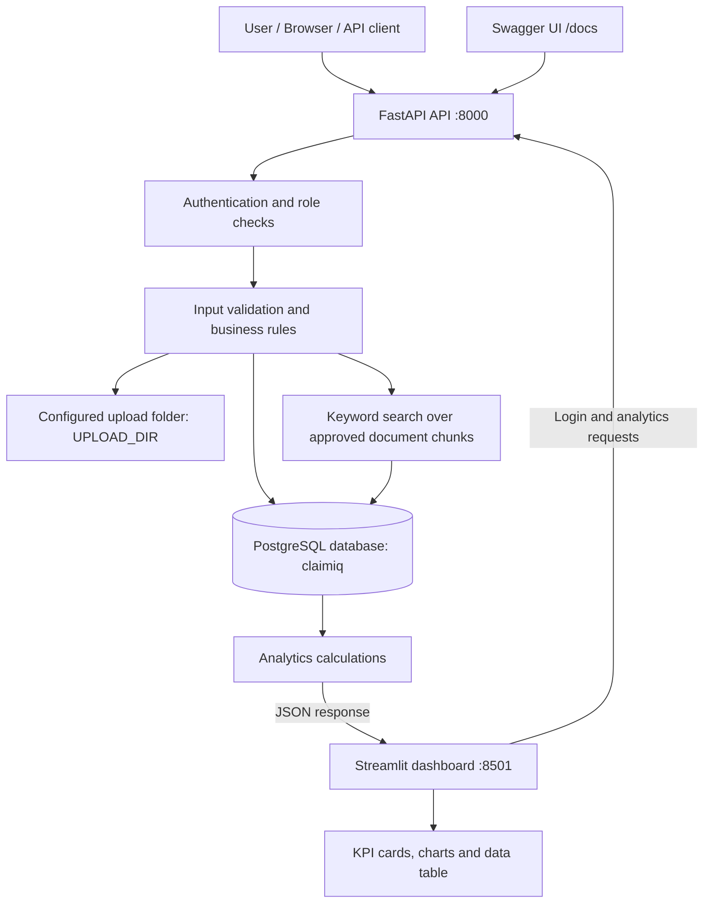
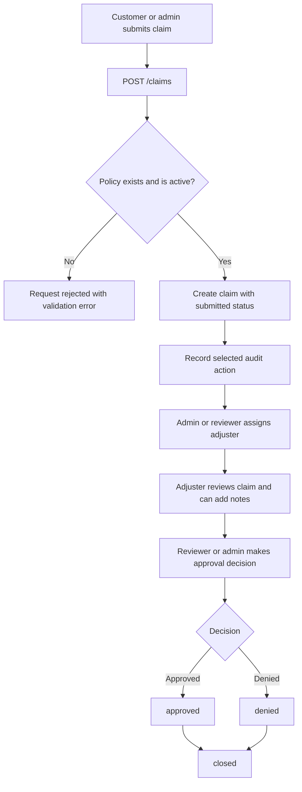
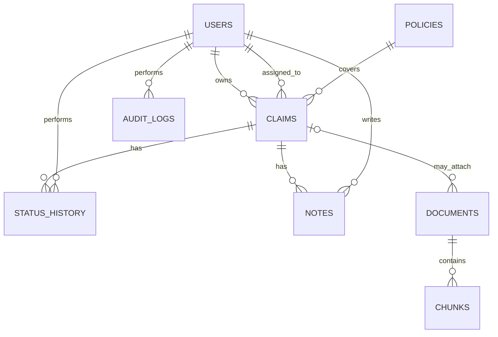
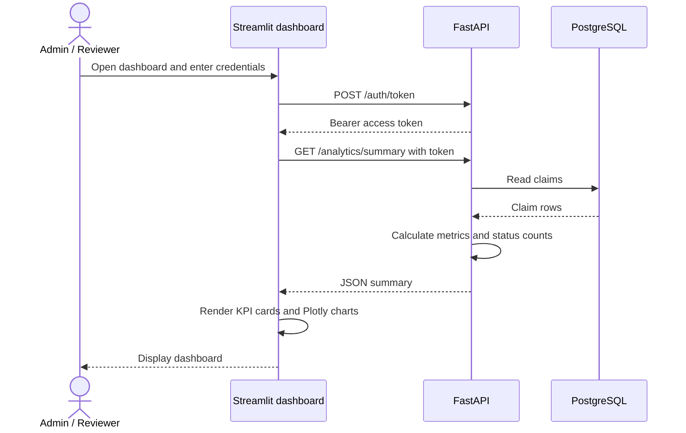

# ClaimIQ — Architecture Readme

> This document explains the current ClaimIQ application in simple English: how its parts connect, what each database table stores, what each column means, how claims move through the system, and how to use the APIs and dashboard.

## 1. What is ClaimIQ?

ClaimIQ is an insurance claims and policy-document application. It provides APIs for users, policies, claims, assignments, status history, notes, documents, document search, analytics, and audit records. A Streamlit dashboard calls the analytics API and displays summary numbers and charts.

In simple terms:

- **FastAPI** receives requests and applies the application's rules.
- **PostgreSQL** stores users, policies, claims and related records.
- **SQLAlchemy** maps Python models to database tables and runs database queries.
- **JWT bearer tokens** identify logged-in users; role checks decide which actions they may perform.
- **The document module** stores uploaded files and extracted text chunks.
- **The analytics API** calculates claim summary numbers when requested.
- **Streamlit** displays those numbers as cards, charts and a table.

**Important current-state note:** the `/rag/ask` endpoint currently uses keyword matching against stored text chunks. It does not currently create embeddings, use ChromaDB/vector search, or call a language model to generate answers. Do not describe it as a full LLM-based RAG implementation until those components are actually added.

## 2. Technology and purpose

| Technology | Purpose |
|---|---|
| Python | Main programming language |
| FastAPI | HTTP API routes and business rules |
| Uvicorn | Runs the FastAPI application |
| PostgreSQL | Persistent relational database |
| SQLAlchemy | Connects Python code to database tables |
| Pydantic | Validates request data |
| JWT bearer token | Carries the authenticated user's identity |
| Pandas | Organizes claim data for analytics calculations |
| PyPDF | Extracts text from PDF files |
| Streamlit | Web-based analytics dashboard |
| Plotly | Creates interactive dashboard charts |
| Requests | Lets Streamlit call FastAPI over HTTP |
| Docker / Docker Compose | Can run the API, dashboard and database as containers when configured |
| pytest | Runs automated tests where configured |

## 3. Overall architecture



### What happens when someone uses the application?

1. The user sends a request using Swagger, a browser/client, or the dashboard.
2. FastAPI receives the request.
3. For protected routes, the API checks the bearer token and the user's role.
4. The endpoint validates the request and applies business rules.
5. SQLAlchemy reads or updates PostgreSQL. File-related endpoints may also access the configured upload folder.
6. FastAPI returns JSON or a file response.
7. The Streamlit dashboard calls the API and displays the analytics JSON as cards and charts.

The dashboard and API are separate applications/processes even when Docker Compose starts them together. Streamlit calls FastAPI; it should not connect directly to PostgreSQL or contain database credentials.

## 4. Main application modules

### Authentication and users
`POST /auth/token` verifies a username and password and returns an access token. Protected calls send `Authorization: Bearer <access_token>`. The role attached to the user controls which endpoints and operations are allowed.

### Policies and claims
A policy is a master record. A claim refers to a policy. Claim creation checks that the referenced policy exists and is active. The claim stores its current status, owner, assigned adjuster, description and amount.

### Assignment, status history and notes
An admin or reviewer can assign a claim to an active adjuster. Status changes follow the allowed workflow. The current status is saved on the claim row, while every status change is recorded separately in `status_history`. Notes are separate records so a comment does not replace the claim description.

### Documents
PDF/TXT files are saved in the configured `UPLOAD_DIR`. The database stores file metadata and a generated storage filename. Extracted text is split into chunks and saved in PostgreSQL. Retrieval only searches documents that are both active and approved.

### Document question/search endpoint
`POST /rag/ask` compares words from a question with words in stored chunks. It returns matching text snippets and citations, or a no-match response. This is keyword retrieval, not semantic/vector search or LLM-generated Q&A.

### Analytics and dashboard
`GET /analytics/summary` calculates total claims, status counts, total amount, average amount and assigned-claim count. Streamlit calls this endpoint and displays the results. Analytics access is restricted to admin and reviewer roles.

## 5. Claim workflow



Normal status transitions in the current implementation:

- `submitted` → `under_review`
- `under_review` → `approved` or `denied`
- `approved` → `closed`
- `denied` → `closed`

An admin can override a non-standard transition only when a non-empty justification is provided. In the current code snapshot, an adjuster cannot set a claim to `approved` or `denied`; a reviewer or admin must make that decision. Keep this description aligned with the actual authorization logic if that code changes.

## 6. Database tables

The current SQLAlchemy models define these eight tables: `users`, `policies`, `claims`, `status_history`, `notes`, `documents`, `chunks`, and `audit_logs`.

### Relationship diagram



A **primary key** uniquely identifies a row. A **foreign key** links a row to another table.

### 6.1 `users` — login accounts

Purpose: stores the accounts that can log in.

| Column | Meaning |
|---|---|
| `id` | Unique user ID; primary key |
| `username` | Unique login name |
| `password_hash` | Hashed password, not the original plain-text password |
| `role` | Permission role, for example `admin`, `reviewer`, `adjuster`, or `customer` |
| `active` | Whether the account is enabled to log in |

### 6.2 `policies` — policy master records

Purpose: stores policy details used to validate claims.

| Column | Meaning |
|---|---|
| `id` | Unique policy ID; primary key |
| `number` | Unique policy number/reference |
| `holder` | Policy holder name |
| `active` | Whether the policy is active |

The claim-creation API rejects a missing or inactive policy.

### 6.3 `claims` — main claim record

Purpose: stores each claim and its current state.

| Column | Meaning |
|---|---|
| `id` | Unique claim ID; primary key |
| `policy_id` | Foreign key to `policies.id` |
| `owner_id` | Foreign key to `users.id`; user who owns/submitted the claim |
| `assigned_to` | Nullable foreign key to `users.id`; assigned adjuster, or `NULL` when unassigned |
| `description` | Description of the claim |
| `status` | Current workflow status; normally starts as `submitted` |
| `amount` | Claim amount stored as an integer; defaults to `0` |

The current model does not define separate claimant-name, claim-type, region, created-date or closed-date columns. Do not assume those columns exist unless the model and database schema are updated.

### 6.4 `status_history` — status change history

Purpose: keeps a record of how a claim's status changed over time.

| Column | Meaning |
|---|---|
| `id` | Unique history row ID; primary key |
| `claim_id` | Foreign key to `claims.id` |
| `actor_id` | Foreign key to `users.id`; user who changed the status |
| `old_status` | Status before the change |
| `new_status` | Status after the change |
| `justification` | Optional reason, especially for an admin override |
| `created_at` | Timestamp; defaults to the current UTC time |

`claims.status` tells you the current status. `status_history` tells you how it got there. The link from a history row to its claim is `status_history.claim_id`.

Example SQL to inspect claim 2:

```sql
SELECT id, claim_id, actor_id, old_status, new_status, justification, created_at
FROM status_history
WHERE claim_id = 2
ORDER BY created_at;
```

### 6.5 `notes` — claim comments

Purpose: stores comments and work notes related to claims.

| Column | Meaning |
|---|---|
| `id` | Unique note ID; primary key |
| `claim_id` | Foreign key to `claims.id` |
| `author_id` | Foreign key to `users.id`; user who wrote the note |
| `text` | Note content |

The current `Note` model does not define a `created_at` column. Add it through a model/schema migration if note timestamps are needed.

### 6.6 `documents` — uploaded file metadata

Purpose: stores information about uploaded files. The actual file bytes are stored in the upload folder, not inside this table.

| Column | Meaning |
|---|---|
| `id` | Unique document ID; primary key |
| `filename` | Original filename displayed to the user |
| `storage_name` | Generated unique filename used to find the file on disk |
| `active` | Whether the document is enabled for retrieval; defaults to `true` |
| `approved` | Whether the document has been approved for retrieval; defaults to `false` |
| `claim_id` | Nullable foreign key to `claims.id`; `NULL` means a general/unlinked document |

A document must be both active and approved to be included in search. Back up both PostgreSQL and the upload folder; the database metadata alone does not contain the uploaded file.

### 6.7 `chunks` — extracted document text

Purpose: stores smaller sections of text extracted from documents. Searching smaller sections helps return relevant excerpts rather than an entire long document.

| Column | Meaning |
|---|---|
| `id` | Unique chunk ID; primary key |
| `document_id` | Foreign key to `documents.id` |
| `ordinal` | Position/order of the chunk within the document, starting at zero |
| `text` | Extracted text for this chunk |

The current upload logic creates chunks of approximately 1,000 characters and limits extracted text to 100,000 characters per file. The pair `document_id` + `ordinal` is unique. This table does not contain embeddings or vector values.

### 6.8 `audit_logs` — selected action records

Purpose: records selected actions so administrators can review what happened.

| Column | Meaning |
|---|---|
| `id` | Unique audit row ID; primary key |
| `actor_id` | Foreign key to `users.id`; user who performed the action |
| `action` | Action name, such as `create`, `assign`, `change_status`, or `upload` |
| `resource` | Resource type, such as `claim`, `policy`, or `document` |
| `created_at` | Timestamp; defaults to the current UTC time |

The audit helper is intended to avoid storing passwords, bearer tokens, full claim descriptions or unnecessary personal information. `GET /audit` is admin-only and returns up to the latest 100 records in the current implementation.

### Tables that are not currently present

The current models do not define separate `chat_query_logs`, `embeddings`, `claim_adjusters`, `payments`, or `analytics_results` tables. Analytics are calculated when requested; the summary is not stored in a separate analytics table.

## 7. Table relationships in simple English

- `claims.policy_id` points to the policy used by the claim.
- `claims.owner_id` identifies the person who owns/submitted the claim.
- `claims.assigned_to` identifies the adjuster assigned to the claim. Both user fields point to `users.id`, but they have different meanings.
- One claim can have many status-history records and many notes.
- Each status-history record points to the claim and the user who made the change.
- Each note points to the claim and the author.
- A document may be attached to a claim or stored as a general policy document.
- One document can contain many chunks; each chunk points back to its source document.
- One user can have many audit-log records.

## 8. API reference

**Local base URL:** `http://127.0.0.1:8000`  
**Swagger UI:** `http://127.0.0.1:8000/docs`  
**ReDoc:** `http://127.0.0.1:8000/redoc`

Swagger allows developers to inspect routes, see request fields, send test requests and inspect responses. Protected routes need a bearer token.

### 8.1 Health and authentication

| Method | Endpoint | Access | Purpose |
|---|---|---|---|
| `GET` | `/health` | Public | Confirms the API is responding |
| `POST` | `/auth/token` | Public | Checks login credentials and returns a token |
| `GET` | `/users/me` | Authenticated | Returns the current user's ID, username and role |
| `GET` | `/users` | Admin or reviewer | Lists users and their roles |

Login sends `username` and `password` as form fields, not as a JSON body. A successful response includes `access_token` and `token_type: "bearer"`.

Send the returned token on later requests:

```http
Authorization: Bearer <access_token>
```

### 8.2 Policies

| Method | Endpoint | Access | Purpose |
|---|---|---|---|
| `GET` | `/policies` | Authenticated user | Lists policy IDs, numbers and active flags |
| `POST` | `/policies` | Admin | Creates a policy; duplicate policy numbers return HTTP 409 |

Example `POST /policies` body:

```json
{
  "number": "POL-10001",
  "holder": "Example Policy Holder",
  "active": true
}
```

### 8.3 Claims, assignment, history and notes

| Method | Endpoint | Access | Purpose |
|---|---|---|---|
| `POST` | `/claims` | Customer or admin | Creates a claim against an active policy |
| `GET` | `/claims` | Authenticated; results filtered by role | Lists claims visible to the user |
| `GET` | `/claims/{claim_id}` | Authenticated with claim visibility | Returns one claim |
| `POST` | `/claims/{claim_id}/assignment` | Admin or reviewer | Assigns a claim to an active adjuster |
| `POST` | `/claims/{claim_id}/status` | Admin, reviewer or adjuster, subject to status rules | Changes status and records history |
| `GET` | `/claims/{claim_id}/history` | Authenticated with claim visibility | Lists status changes |
| `POST` | `/claims/{claim_id}/notes` | Admin, reviewer or adjuster | Adds a note to a claim |
| `GET` | `/claims/{claim_id}/notes` | Authenticated with claim visibility | Lists notes for a claim |

Example `POST /claims` body:

```json
{
  "policy_id": 1,
  "description": "Water damage to the insured property",
  "amount": 25000
}
```

The API derives `owner_id` from the authenticated user rather than trusting a caller-supplied owner ID.

Example assignment body:

```json
{
  "user_id": 3
}
```

The selected user must be active and have the `adjuster` role.

Example status-change body:

```json
{
  "status": "under_review"
}
```

For an admin override, provide a non-empty justification:

```json
{
  "status": "closed",
  "justification": "Administrative correction after review"
}
```

Example note body:

```json
{
  "text": "Reviewed the supporting documents."
}
```

### 8.4 Documents

| Method | Endpoint | Access | Purpose |
|---|---|---|---|
| `POST` | `/documents` | Admin, reviewer or adjuster; claim visibility applies if linked | Uploads PDF/TXT and creates text chunks |
| `GET` | `/documents` | Admin, reviewer or adjuster | Lists document metadata visible to the caller |
| `GET` | `/documents/{document_id}/download` | Authenticated with access checks | Downloads the file |
| `PATCH` | `/documents/{document_id}` | Admin or reviewer | Changes active/approved flags |

Upload uses `multipart/form-data`; the file field is named `file`. An optional `claim_id` form field links the document to a claim. The current code accepts PDF and TXT files and limits uploads to 5,000,000 bytes. New documents are active by default but not approved by default.

Example `PATCH /documents/{document_id}` body:

```json
{
  "active": true,
  "approved": true
}
```

### 8.5 Document question/search endpoint

| Method | Endpoint | Access | Purpose |
|---|---|---|---|
| `POST` | `/rag/ask` | Authenticated; visibility rules apply to claim-linked documents | Searches active, approved chunks and returns source text/citations |

Example request:

```json
{
  "question": "What is the water damage deductible?"
}
```

The response contains an `answer` and a `citations` array. Citations identify the source using fields such as `document_id`, `chunk_id` and `filename`. If no chunks match, the current implementation returns `No matching approved source found.` and an empty citations array.

**Current limitation:** this endpoint uses word overlap. It is not semantic/vector search and does not call a generative AI model.

### 8.6 Analytics and audit

| Method | Endpoint | Access | Purpose |
|---|---|---|---|
| `GET` | `/analytics/summary` | Admin or reviewer | Returns claim KPIs and status counts |
| `GET` | `/audit` | Admin | Returns up to the latest 100 audit records |

Current `/analytics/summary` response fields:

| Field | Meaning |
|---|---|
| `total_claims` | Total number of claims |
| `by_status` | Count of claims for each status |
| `total_amount` | Sum of claim amounts |
| `average_amount` | Average claim amount |
| `assigned_claims` | Number of claims with an assigned adjuster |

When there are no claims, the endpoint returns zero values and an empty `by_status` object. The current schema does not have claim dates, region or claim type, so reliable time trends, regional breakdowns and turnaround-time reports cannot be calculated from the current columns alone.

### 8.7 Common HTTP status codes

| Code | Meaning | Example |
|---|---|---|
| `200` | Request succeeded | Read or update succeeded |
| `401` | Not authenticated | Invalid login or missing/invalid token |
| `403` | Authenticated, but permission is insufficient | Role cannot access an endpoint |
| `404` | Record not found or intentionally hidden | Wrong ID or claim not visible to caller |
| `409` | Conflict | Duplicate policy or invalid status transition |
| `413` | File too large | Upload exceeds the size limit |
| `415` | Unsupported file type | Upload is not PDF/TXT |
| `422` | Input validation or business-rule failure | Required field missing or policy inactive |

## 9. Roles and permissions

| Action | Admin | Reviewer | Adjuster | Customer |
|---|---:|---:|---:|---:|
| Log in and view own profile | Yes | Yes | Yes | Yes |
| List users | Yes | Yes | No | No |
| List policies | Yes | Yes | Yes | Yes |
| Create policy | Yes | No | No | No |
| Create claim | Yes | No | No | Yes |
| List claims | All | All | Assigned claims | Own claims |
| Assign claim | Yes | Yes | No | No |
| Change status | Yes | Yes | Yes, except approve/deny | No |
| Add note | Yes | Yes | Yes, for visible claims | No |
| List/upload documents | Yes | Yes | Yes, subject to visibility rules | No |
| Change document approval/active flags | Yes | Yes | No | No |
| Ask a document question | Yes | Yes | Yes, subject to visibility rules | Yes, subject to visibility rules |
| View analytics | Yes | Yes | No | No |
| View audit log | Yes | No | No | No |

The API is the security boundary. Hiding a dashboard button is not sufficient security; permissions must be enforced by backend checks. Confirm this table against the current route decorators/checks whenever permissions change.

## 10. Streamlit dashboard integration



The dashboard displays total claims, assigned claims, unassigned claims, total claim amount, average claim amount, status distribution and a status table. It has refresh and logout actions. It uses the same API authorization checks as other clients.

For local development, FastAPI normally uses port `8000` and Streamlit uses port `8501`. The dashboard's `CLAIMIQ_API_URL` defaults to `http://127.0.0.1:8000`. In Docker Compose, use the real API service name and internal port, such as `http://api:8000` only if the service is named `api`. Inside a container, `localhost` refers to that same container, not another service container.

## 11. Running locally

Run these commands from the repository root and follow the project's setup guide for the correct virtual environment and database configuration.

Start FastAPI:

```powershell
.\.venv64\Scripts\python.exe -m uvicorn app.main:app --reload --host 127.0.0.1 --port 8000
```

Open Swagger: `http://127.0.0.1:8000/docs`.

Install dashboard dependencies if needed:

```powershell
.\.venv64\Scripts\python.exe -m pip install -r dashboard\requirements.txt
```

Start Streamlit in a second terminal:

```powershell
.\.venv64\Scripts\python.exe -m streamlit run dashboard\app.py
```

Open `http://localhost:8501`. PostgreSQL must be running and the application's database URL must point to the intended database. Use demo credentials only for local development; use the repository's seed/setup instructions to find the local accounts.

## 12. Security and data safety

- Keep database URLs, JWT secrets and real passwords out of source control.
- Configure the database connection and upload directory through environment/configuration settings.
- Ensure the API process can write to `UPLOAD_DIR`.
- Do not expose the upload directory as a public static folder.
- Back up both PostgreSQL and the upload directory.
- Do not point tests at a valuable database; use the disposable test database configured for the project.
- Use HTTPS and proper secret management before exposing the application outside a trusted development environment.
- Do not put passwords, bearer tokens or unnecessary personal information in logs.
- Demo credentials are for local development only.

## 13. Troubleshooting

| Problem | What to check |
|---|---|
| API cannot connect to PostgreSQL | Check PostgreSQL service, host/port, credentials and database URL |
| Login returns `401` | Check username/password and whether the user is active |
| Protected API returns `401` | Send `Authorization: Bearer <access_token>` |
| API returns `403` | Confirm the logged-in role has permission |
| Claim creation fails | Confirm required fields are present and the policy exists and is active |
| Adjuster cannot see a claim | Check whether `claims.assigned_to` matches the adjuster's `users.id` |
| Document search returns no match | Check document `active` and `approved` flags and whether question words occur in extracted text |
| Download says file missing | Check whether `storage_name` exists under `UPLOAD_DIR` |
| Dashboard cannot connect to API | Confirm API is running and `CLAIMIQ_API_URL` has the correct host/port |
| Dashboard analytics returns `403` | Sign in as admin or reviewer |
| Dashboard shows zeros | Confirm claims exist and `/analytics/summary` returns non-zero values |

Useful checks from the project environment:

```powershell
Invoke-RestMethod http://127.0.0.1:8000/health
pytest -q
python -m compileall -q app
```

Use any additional test/lint commands listed in the project's setup documentation.

## 14. Current features and possible future improvements

| Area | Current implementation | Possible future work |
|---|---|---|
| Claims | Policy-linked claims, assignment, status changes, notes and history | Add claimant details, created/closed timestamps, claim type and region if required |
| Analytics | Claim counts, status counts, total/average amount, assigned claims | Add required date/region/type data before building trend and turnaround reports |
| Document search | PDF/TXT extraction, chunks, keyword matching and citations | Add embeddings, vector search and optionally an LLM generation step |
| Query logging | No dedicated chat-query log table currently | Add query logging if audit, quality or usage tracking is required |
| Notes | Claim, author and text | Add `created_at` if note timestamps are required |
| Dashboard | Streamlit calls authenticated analytics API | Add filters and charts after the API exposes the necessary data |
| Deployment | Local run commands; containers depend on project configuration | Add production secrets, HTTPS, monitoring, backups and persistent file storage |

Do not describe the current keyword search as an Azure OpenAI/ChromaDB implementation unless those integrations have been added and tested.

## 15. Glossary

| Term | Simple explanation |
|---|---|
| API | A defined way for one program to ask another program to do something |
| Endpoint | One API URL, such as `/claims` |
| `GET` | Usually reads data |
| `POST` | Usually creates or submits data |
| `PATCH` | Updates part of an existing record |
| Authentication | Checks who the user is |
| Authorization | Checks what the user is allowed to do |
| Bearer token | Token sent in an HTTP header after login |
| Primary key | Column that uniquely identifies a row |
| Foreign key | Column that links one table to another |
| SQLAlchemy model | Python class describing a database table |
| Migration | Controlled change to the database structure |
| Chunk | A smaller piece of extracted document text |
| Keyword retrieval | Finds text using overlapping words |
| Embedding | Numeric representation of text used for similarity search; not present in the current chunk model |
| Vector database | Stores embeddings for similarity search; not used by the current retrieval endpoint |
| RAG | Retrieval-Augmented Generation: retrieve source material and use a language model to create a grounded answer |
| KPI | A key number, such as total claims |
| Audit log | A record of selected important actions |

## 16. One-minute summary

- FastAPI owns the API routes and business rules.
- PostgreSQL stores eight tables: `users`, `policies`, `claims`, `status_history`, `notes`, `documents`, `chunks`, and `audit_logs`.
- The API uses bearer tokens and role checks.
- A claim must reference an active policy.
- `claims` stores the current status; `status_history` records each change.
- Document file bytes live in `UPLOAD_DIR`; document metadata and extracted text chunks live in PostgreSQL.
- `/rag/ask` searches active, approved chunks by keyword and returns citations. It is not yet a vector/LLM RAG pipeline.
- `/analytics/summary` calculates the current claim KPIs.
- Streamlit calls that endpoint and shows the results as cards and charts.

Update this document whenever the database models, permissions, workflow, API routes, dashboard behavior or document retrieval implementation changes.
