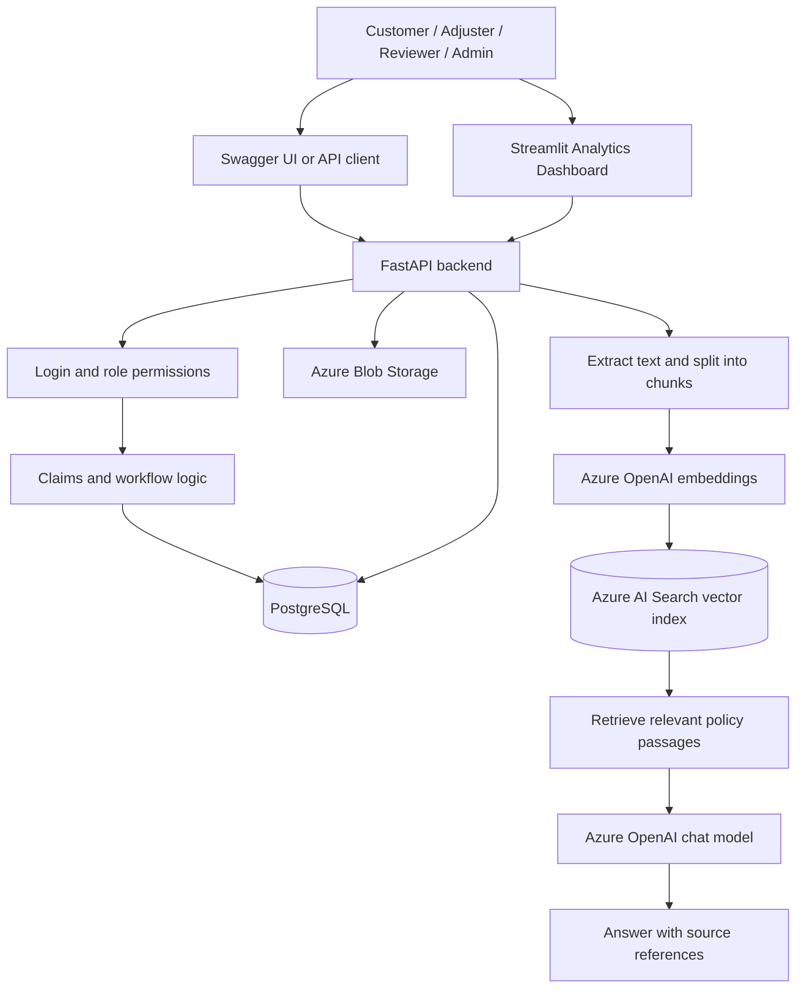

# ClaimIQ Architecture Guide

This guide explains what the current ClaimIQ code does, in plain language. You do not need programming experience to follow the main sections.

## 1. What is ClaimIQ?

ClaimIQ is a demonstration application with two related capabilities:

1. **Claims Management** — customers submit insurance claims; claims can be assigned to adjusters, reviewed, commented on, and moved through a controlled status workflow.
2. **Policy Document Q&A (RAG)** — an authorized user uploads a policy document, the system processes its text, and a user can ask a question about the processed policy. The answer is generated using relevant passages from the policy and includes source references.

It also provides an analytics API and a Streamlit dashboard.

> **Important:** RAG is included in this codebase. It is not just a keyword search. The document workflow extracts text, splits it into chunks, creates embeddings, stores searchable vectors in Azure AI Search, retrieves relevant passages, and sends those passages to the configured Azure OpenAI chat deployment to draft an answer. The response includes source information. The answer is assistance for a human reviewer, not an automatic claim decision.

## 2. Simple overview

### What each part means

| Part | In simple words |
|---|---|
| FastAPI | The backend that receives requests and applies the application's rules. |
| Swagger UI (`/docs`) | A web page for trying the API endpoints manually. |
| PostgreSQL | The database that stores users, policies, claims, notes, status history, document records, and query logs. |
| JWT token | A temporary login credential sent with protected API requests. |
| Azure Blob Storage | Stores uploaded policy files. |
| Text extraction | Reads text from a supported PDF or DOCX file. Scanned PDFs may need OCR, which this project does not provide. |
| Chunking | Splits extracted text into smaller passages so relevant sections can be found. |
| Embeddings | Converts text into numeric vectors that represent meaning. |
| Azure AI Search | Finds relevant passages from the indexed policy chunks. |
| Azure OpenAI chat deployment | Writes a response using the retrieved policy passages and the RAG prompt. |
| Streamlit dashboard | Shows claim totals, assigned/unassigned claims, amounts, and status charts by calling the analytics API. |

## 3. Claims Management

### Typical claim flow

1. A user signs in and receives a token.
2. A customer submits a claim against an active policy that belongs to that customer.
3. The system automatically assigns the new claim to an active adjuster with the fewest open claims.
4. An authorized user reviews the claim and changes its status according to the allowed workflow.
5. Status changes are recorded in claim status history. Notes are saved separately from the claim description.
6. Admins and reviewers can view the analytics summary. Admins can inspect audit records.

### Allowed claim statuses

The status values used by the code are lowercase:

`submitted` → `under_review` → (`approved` or `denied`) → `closed`

The API enforces the transition rules. An invalid transition can only be overridden by an admin, and an admin override requires a justification. Adjusters can move a claim to `under_review`, but cannot approve or deny it.

### Roles at a glance

| Role | Main capabilities in the current code |
|---|---|
| `customer` | View own policies and claims; submit a claim against their own active policy. |
| `adjuster` | View claims assigned to them; add notes; move assigned claims to review; ask policy questions. |
| `reviewer` | Review and assign claims, make approval/denial decisions, add notes, view analytics, and ask policy questions. |
| `admin` | Administer users/policies, assign claims, override invalid status transitions with justification, view audit logs and analytics, manage policy documents, and ask policy questions. |
| `support_agent` | View claims/documents permitted by the API and ask policy questions; does not receive claim mutation permissions by default. |

Every endpoint has its own permission checks. Use Swagger to confirm the response for a particular role.

## 4. Policy Document Q&A (RAG)

RAG means **Retrieval-Augmented Generation**. In plain language, ClaimIQ first looks up relevant sections in processed policy documents and then asks the configured AI model to answer using those sections.

### How a policy document becomes searchable

1. An admin uploads a PDF or DOCX using `POST /documents`.
2. ClaimIQ saves the file to Azure Blob Storage and records its metadata in PostgreSQL. The initial status is `UPLOADED`.
3. An admin calls `POST /documents/{document_id}/process`.
4. ClaimIQ downloads the file, extracts text, splits it into chunks, generates an embedding for each chunk, and uploads those chunks to the Azure AI Search index.
5. When processing succeeds, the document status becomes `ACTIVE` and its chunks are available for retrieval.
6. An authorized user submits a question to `POST /ai/query`.
7. ClaimIQ embeds the question, searches Azure AI Search, filters results using the configured minimum score, and sends the matching passages to Azure OpenAI.
8. The response contains an answer, source references (document name/version/page where available), response time, and a status.

### Important RAG details

- Uploading a file directly in the Azure Portal does **not** register it in ClaimIQ's database or process it. Use the ClaimIQ upload endpoint so the application has a document ID.
- The Azure AI Search index must exist. `python -m app.init_db` creates database tables, seeds demo data, and calls the search-index setup script.
- Processing needs working configuration and access for Blob Storage, Azure AI Search, Azure OpenAI embeddings, and the chat deployment.
- Only successfully processed/active policy chunks should be used for answers. The answer may return a no-match response when relevant evidence is not found or confidence is too low.
- The current extractor supports PDF and DOCX uploads. Image-only/scanned PDFs may fail because OCR is not implemented.
- The AI response supports assessment. It does not approve, deny, or change a claim automatically.
- RAG query logs are stored in PostgreSQL. Common ID-like numbers, phone numbers, and email addresses are redacted from the saved question/answer text by the current logging helper; this is not a guarantee that every kind of sensitive data is detected.

### Current API paths

The app registers the document and AI routes both without and with the `/api/v1` prefix. For example, both `/documents` and `/api/v1/documents` are registered, as are `/ai/query` and `/api/v1/ai/query`. Use the unversioned routes shown in the Swagger testing guide unless your deployment specifically standardizes on the versioned prefix.

## 5. Analytics dashboard

The dashboard lives in `dashboard/app.py` and uses Streamlit. It is a separate process from FastAPI.

- FastAPI default address: `http://127.0.0.1:8000`
- Swagger UI: `http://127.0.0.1:8000/docs`
- Streamlit dashboard default address: `http://localhost:8501`

The dashboard logs in through `/auth/token`, then calls `/analytics/summary` with the returned bearer token. The endpoint is restricted to `admin` and `reviewer`. The dashboard shows claim totals, assigned and unassigned counts, total/average claimed amounts, and status charts.

## 6. Database tables in plain language

| Table | What it stores |
|---|---|
| `users` | Usernames, password hashes, roles, and active/inactive state. |
| `policies` | Policy number, holder, owner/customer, and active state. |
| `claims` | Claim description, amount, customer, policy, assigned adjuster, current status, and workflow timestamps. |
| `claim_status_history` | Each recorded status transition, who performed it, and any justification saved for an admin override. |
| `claim_notes` | Notes/comments attached to a claim and the user who wrote each note. |
| `audit_logs` | Metadata about selected actions, such as the actor, action, and resource. |
| `documents` | Uploaded policy document metadata, status, version, effective date, and Blob Storage path. |
| `document_chunks` | Extracted passages from a document, including chunk number, page number, and active state. |
| `chat_query_logs` | Policy questions, answers, source references, response time, status, and user. |

The actual database table names are defined in `app/models.py`. If you inspect the database, use `\dt` in `psql` to see the exact table names.

## 7. Key API endpoints

| Method | Endpoint | Purpose |
|---|---|---|
| `GET` | `/health` | Check that the API process responds. |
| `POST` | `/auth/token` | Sign in and receive a bearer token. |
| `GET` | `/users/me` | View the current user's identity and role. |
| `GET` | `/users` | List users (admin/reviewer). |
| `GET` | `/policies` | List policies for an authenticated user. |
| `POST` | `/policies` | Create a policy (admin only in the current code). |
| `POST` | `/claims` | Submit a claim. |
| `GET` | `/claims` | List claims visible to the signed-in user. |
| `GET` | `/claims/{claim_id}` | Read a claim. |
| `POST` | `/claims/{claim_id}/assignment` | Assign an active adjuster (admin/reviewer). |
| `POST` | `/claims/{claim_id}/status` | Change claim status subject to workflow permissions. |
| `GET` | `/claims/{claim_id}/history` | View claim status history. |
| `POST` | `/claims/{claim_id}/notes` | Add a claim note. |
| `GET` | `/claims/{claim_id}/notes` | List claim notes. |
| `GET` | `/analytics/summary` | Get analytics (admin/reviewer). |
| `GET` | `/audit` | View audit records (admin). |
| `POST` | `/documents` | Upload a policy PDF/DOCX (admin). |
| `POST` | `/documents/{document_id}/process` | Extract, chunk, embed, and index a document (admin). |
| `GET` | `/documents` | List uploaded documents for authorized roles. |
| `GET` | `/documents/{document_id}` | Read document metadata for authorized roles. |
| `PATCH` | `/documents/{document_id}/activation` | Activate/deactivate a processed document (admin). |
| `POST` | `/ai/query` | Ask a question about processed policy documents. |

Swagger `/docs` is the authoritative live list for the checked-out code.

## 8. Important limitations and safety notes

- This is a local/demo setup, not a production deployment guide.
- Demo accounts and `demo123` passwords are for local testing only.
- The default JWT secret is not suitable for production. Set a strong secret through `.env`.
- Do not commit `.env` or share real credentials.
- A successful `/health` response confirms the API process is running; it does not prove PostgreSQL or Azure services are reachable.
- ClaimIQ does not itself verify that an AI answer is correct. A human adjuster must validate policy language and claim evidence.
